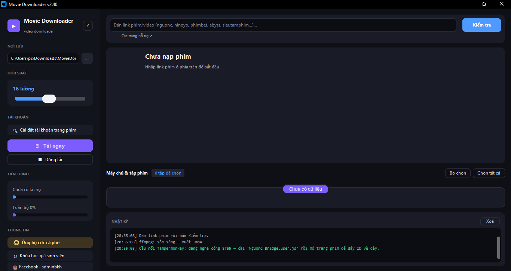
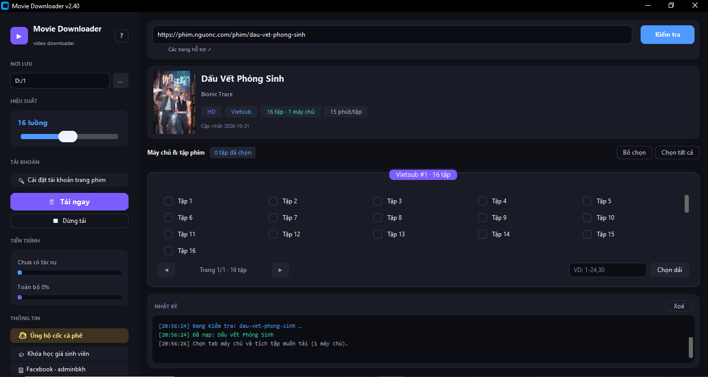

# 🎬 Movie Downloader — Phần mềm tải phim, tải video miễn phí cho Windows

### Tải phim vietsub, thuyết minh · Tải video YouTube 4K, TikTok không logo, Facebook Reel, Bilibili… tất cả trong một công cụ duy nhất

**🎬 Movie Downloader** là phần mềm tải phim và tải video **miễn phí** trên Windows với giao diện tiếng Việt hiện đại. Chỉ cần **dán link** — tool tự nhận diện 15 nguồn hỗ trợ, tự liệt kê server, chất lượng và danh sách tập, tải về thành file **MP4 hoàn chỉnh** (tự ghép âm thanh + hình ảnh). Không quảng cáo, không giới hạn số lượt tải, không cần cài thêm bất cứ thứ gì.

**▶ Xem video giới thiệu sản phẩm trên YouTube: [youtu.be/5WpIF-61MKQ](https://youtu.be/5WpIF-61MKQ)**

---

## 📸 Ảnh giao diện

| Giao diện chính | Dán link — tự quét server, chất lượng, tập |
|---|---|
|  |  |

---

## 📑 Mục lục

- [Tính năng nổi bật](#-tính-năng-nổi-bật)
- [Các trang web hỗ trợ](#-các-trang-web-hỗ-trợ)
- [Hướng dẫn chi tiết từng trang](#-hướng-dẫn-chi-tiết-từng-trang)
- [Tải về & cài đặt](#-tải-về--cài-đặt)
- [Câu hỏi thường gặp (FAQ)](#-câu-hỏi-thường-gặp-faq)
- [Thông tin tác giả](#-thông-tin-tác-giả)

---

## ✨ Tính năng nổi bật

- 🔗 **Dán link là tải** — tự nhận diện nguồn, không cần chọn trang web trước
- 🖥️ **Giao diện tiếng Việt** hiện đại, giao diện tối (dark mode), dễ dùng với mọi lứa tuổi
- 🎞️ **Đầy đủ server & chất lượng** — Vietsub / Thuyết minh / các server dự phòng, chất lượng từ 144P đến 4K
- 📺 **Tải cả playlist YouTube** — dán link playlist là tải toàn bộ video trong danh sách
- 🚫 **TikTok không logo** — tải bản gốc không dán watermark
- ⚡ **Tải song song tới 16 luồng** — điều chỉnh bằng thanh trượt, tiết kiệm thời gian
- ⏸️ **Tạm dừng & tự tiếp tục (resume)** — dừng tải rồi chạy lại, tool tiếp tục từ chỗ dở, không mất phần đã tải
- 🧩 **Tự ghép video + âm thanh** bằng ffmpeg — xuất file **MP4** mở được bằng mọi trình phát
- 🔢 **Phim nghìn tập vẫn nhẹ nhàng** — phân trang 30 tập/lần, chọn nhanh khoảng tập `1-24,30`
- 🧹 **Không quảng cáo, không pop-up, không thu phí** — 100% miễn phí

---

## 🌐 Các trang web hỗ trợ

| Trang web | Loại nội dung | Chất lượng / Ghi chú |
|---|---|---|
| [phim.nguonc.com](https://phim.nguonc.com) | Phim bộ / phim lẻ | Nhiều server (Vietsub, Thuyết minh…) · tự đủ danh sách tập |
| [ninoyo.online](https://ninoyo.online) | Phim | Tự dò số tập qua API · không cần đăng nhập |
| [phimbet.top](https://phimbet.top) | Phim | Nguồn Abyss · tự lấy chất lượng tốt nhất |
| [animesub.site](https://animesub.site) | Anime | Nhiều nhóm phụ đề (tự tách server riêng cho từng nhóm) |
| animevietsub (.li/.nl/…) | Anime | Server HDX · tải trực tiếp, không cần cầu nối |
| [anime47.best](https://anime47.best) | Anime | **HLS 1080p** · web bắt buộc đăng nhập (lưu tài khoản 1 lần trong tool) |
| cobephim (.icu/.com/…) | Phim | Nhiều server qua API · tự nhận mọi tên miền cobephim |
| [bilibili.tv](https://www.bilibili.tv/vi) | Phim / Anime | Tối đa 480P miễn phí · **tự lọc tập VIP** · tự ghép video + audio |
| [facebook.com](https://www.facebook.com) | Reel / Watch / Video | HD 720p + SD 360p · video công khai |
| [tiktok.com](https://www.tiktok.com) | Video TikTok | **HD không logo** + bản có logo |
| [threads.com](https://www.threads.com) | Video Threads (Meta) | MP4 trực tiếp bản tốt nhất · bài công khai |
| [youtube.com](https://www.youtube.com) · youtu.be | Video + **Playlist** | 240p → **2160p (4K)** · tự tải yt-dlp |
| abysscdn.com · abyss.to · short.ink · playhydrax.com · zplayer.io · abyssplayer.com | Video đơn lẻ | Tích chọn chất lượng 360p / 720p / 1080p |
| [clbphimxua.com](https://clbphimxua.com) | Phim bộ nhiều tập | Cần tài khoản trang (lưu 1 lần trong tool) |
| [sieutamphim.pro](https://www.sieutamphim.pro) | Phim | Cần cầu nối Tampermonkey (cài 1 lần — xem hướng dẫn bên dưới) |

> 💡 Chỉ cần **dán link vào ô Kiểm tra** — tool tự nhận diện nguồn, kể cả khi trang đổi tên miền (ví dụ cobephim đổi .icu sang .com).

---

## 📖 Hướng dẫn chi tiết từng trang

### 1. phim.nguonc.com — phim bộ, phim lẻ vietsub/thuyết minh
1. Mở phim trên **phim.nguonc.com**, sao chép link dạng `https://phim.nguonc.com/phim/ten-phim`
2. Dán vào ô link → bấm **Kiểm tra** → tool tự nạp đủ danh sách tập (kể cả tập mới cập nhật)
3. Chọn tab máy chủ (**Vietsub**, **Thuyết minh**, các server dự phòng…)
4. Tích các tập muốn tải (hoặc gõ khoảng tập `1-24,30` rồi bấm **Chọn dài**)
5. Bấm **Tải ngay** → từng tập được tải về thành `tap-N.mp4`

### 2. YouTube — video lẻ và cả playlist, lên tới 4K
1. Sao chép link video (`https://www.youtube.com/watch?v=…` hoặc `https://youtu.be/…`)
   - Muốn tải **cả playlist**: dán link có `list=…`
2. Bấm **Kiểm tra** → tool liệt kê **mọi chất lượng có sẵn**: 144p, 240p, 360p, 720p, 1080p, 1440p (2K), **2160p (4K)**…
3. Tích chất lượng muốn tải (với playlist: tool tải cả danh sách ở chất lượng tốt nhất)
4. **Tải ngay** — lần đầu chạy tool sẽ tự tải yt-dlp (~17MB) và ffmpeg (~95MB), các lần sau không cần nữa

### 3. TikTok — tải video không logo (bản gốc)
1. Sao chép link video TikTok dạng `https://www.tiktok.com/@user/video/123456789`
2. **Kiểm tra** → tool hiện 2 lựa chọn: **HD không logo** (bản gốc, không dán watermark) và bản có logo TikTok
3. Chọn bản muốn tải → **Tải ngay** → nhận file MP4 nguyên bản

### 4. Facebook Reel / Watch / Video
1. Sao chép link Reel dạng `https://www.facebook.com/reel/123456789` (hoặc link Watch/video công khai)
2. **Kiểm tra** → tool hiện **HD 720p** và **SD 360p**
3. Chọn chất lượng → **Tải ngay**

### 5. Threads — video từ threads.com (Meta)
1. Mở bài post có video trên Threads, sao chép link dạng `https://www.threads.com/@user/post/CODE` (có hoặc không có đuôi `/media` đều được)
2. **Kiểm tra** → tool tự tìm video trong bài
3. **Tải ngay** → MP4 trực tiếp. Lưu ý: chỉ tải được bài **công khai**; bài riêng tư hoặc bài chỉ có ảnh sẽ được báo rõ

### 6. bilibili.tv — phim, anime bản quyền
1. Sao chép link dạng `https://www.bilibili.tv/vi/play/2097863`
2. **Kiểm tra** → tool quét toàn bộ tập, **tự loại các tập VIP** và liệt kê các tập tải được (ví dụ Tập 1, Tập 2, tập đặc biệt…)
3. Chọn tab chất lượng: **480P / 360P / 240P / 144P** (720p, 1080p là nội dung VIP của bilibili)
4. Tích tập → **Tải ngay** — tool tự tải riêng video và âm thanh rồi **ghép thành MP4** bằng ffmpeg

### 7. cobephim — nhiều server, nhiều chất lượng
1. Dán link phim trên bất kỳ tên miền cobephim (.icu/.com/…) → **Kiểm tra**
2. Mỗi server là một tab riêng (gồm cả server **Thuyết minh** nếu phim có)
3. Trong mỗi server, chọn tab chất lượng rồi tích tập → **Tải ngay**

### 8. animesub.site — anime nhiều nhóm phụ đề
1. Dán link dạng `https://animesub.site/phim/mao-6189.html` → **Kiểm tra**
2. Với anime có nhiều nhóm dịch (ví dụ phim dài 104 tập của 4 nhóm phụ đề), tool **tự tách từng nhóm thành server riêng** — chọn đúng nhóm mình đang theo dõi
3. Tích tập → **Tải ngay**

### 9. animevietsub — anime server HDX
1. Dán link phim (mọi tên miền animevietsub: .li/.nl/…) → **Kiểm tra**
2. Tool tự lấy qua server HDX, **không cần cài cầu nối gì thêm**
3. Tích tập → **Tải ngay**

### 10. anime47.best — anime 1080p (web yêu cầu đăng nhập)
Trang này **bắt buộc có tài khoản** mới xem được, làm 1 lần duy nhất:
1. Bấm **🔑 Cài đặt tài khoản trang phim** ở cột trái
2. Nhập Email + Mật khẩu tài khoản anime47.best → **Lưu**
3. Dán link phim dạng `https://anime47.best/phim/ten-anime/m10208.html` → **Kiểm tra** → tool tự đăng nhập, nạp đủ tập với các server 1080p → tích tập → **Tải ngay**

### 11. phimbet.top / ninoyo.online — phim nhanh gọn
1. Dán link phim → **Kiểm tra** → tool tự lấy chất lượng tốt nhất có sẵn
2. Tích tập → **Tải ngay** (với phimbet có thể chọn mức chất lượng Cao nhất / Trung bình / Thấp nhất ở menu bên trái)

### 12. Link video đơn lẻ (Abyss) — abysscdn.com, abyss.to, short.ink, playhydrax.com…
1. Dán link video đang mở (kiểu `https://abysscdn.com/?v=…`, `https://short.ink/…`) → **Kiểm tra**
2. Tool liệt kê các chất lượng (360p / 720p / 1080p) — tích chất lượng muốn tải
3. **Tải ngay**

### 13. clbphimxua.com — phim bộ cần tài khoản
1. Bấm **🔑 Cài đặt tài khoản trang phim** ở cột trái
2. Nhập Email/Mật khẩu của clbphimxua.com → **Lưu** (chỉ làm 1 lần, lưu trên máy bạn)
3. Dán link phim → **Kiểm tra** → tool tự đăng nhập và nạp đủ tập → **Tải ngay**

### 14. sieutamphim.pro — cần cầu nối Tampermonkey (cài 1 lần)
Trang này bật Cloudflare nên lần đầu cần làm thêm 3 bước nhỏ:
1. Cài tiện ích **Tampermonkey** vào Chrome/Edge
2. Mở file **`Movie Downloader Bridge.user.js`** trong kho này → bấm **Install**
3. Giữ tool đang chạy, mở trang phim trên sieutamphim → góc phải dưới hiện **"đã gửi X tập ✓"** → tool tự nạp danh sách → tải như bình thường

Hỗ trợ cả nguồn Abyss, VK Video (vk.ru) và OK.ru — mỗi nguồn là một nhóm server riêng.

---

## ⬇️ Tải về & cài đặt

1. Vào mục [**Releases**](../../releases) → tải file **`MovieDownloader.exe`** mới nhất
2. Chạy file trực tiếp — **không cần cài đặt, không cần Python**
3. Dán link phim/video và tải!

**Yêu cầu hệ thống:** Windows 10 / Windows 11 **64-bit** (không hỗ trợ Windows 32-bit)
**Lưu ý lần đầu chạy:** khi tải nguồn cần ghép âm thanh (nguonc, bilibili, anime47, YouTube…), tool tự tải **ffmpeg** (~95MB, 1 lần duy nhất) — các lần sau dùng lại ngay.

> ⚠️ Nếu Windows SmartScreen hiện cảnh báo, chọn **"Run anyway"** — file exe chưa ký số (bình thường với ứng dụng miễn phí nhỏ lẻ). Mã nguồn mở tại repo này, bạn có thể tự kiểm tra và tự build.

---

## ❓ Câu hỏi thường gặp (FAQ)

**Movie Downloader có hoàn toàn miễn phí không?**
Có. Không thu phí, không quảng cáo, không giới hạn số lượt tải.

**Có cần cài Python hay phần mềm nào khác không?**
Không. File `MovieDownloader.exe` đã chứa sẵn tất cả. ffmpeg và yt-dlp (dùng cho YouTube) sẽ được tool tự tải về khi cần, chỉ 1 lần.

**Vì sao phim bilibili.tv chỉ hiện vài tập?**
Các tập còn lại là nội dung **VIP** của bilibili.tv — tool tự lọc và chỉ hiện những tập tải được ở chế độ miễn phí. Tương tự, chất lượng cao nhất miễn phí của bilibili là 480P.

**Vì sao không tải được video Facebook ở chế độ riêng tư?**
Chỉ những Reel / Video **công khai** mới tải được — tool không truy cập nội dung riêng tư của người khác. Video Threads cũng vậy.

**Vì sao anime47.best cần tài khoản mà các trang phim khác không cần?**
Vì trang này tự khóa nội dung sau đăng nhập (API trả lỗi nếu chưa đăng nhập). Bạn chỉ cần lưu tài khoản 1 lần trong **Cài đặt tài khoản trang phim** — tool tự đăng nhập mỗi lần tải, tài khoản chỉ nằm trên máy bạn.

**Tải dở mà tắt máy/tạm dừng thì có mất dữ liệu không?**
Không. Bấm **Dừng tải** hoặc tắt tool giữa chừng, lần chạy sau sẽ **tự tiếp tục từ phần đã tải**.

**Có hỗ trợ Windows 32-bit (win32) không?**
Không, tool chỉ có bản **64-bit** — máy tính thời nay đều dùng 64-bit.

**Tải playlist YouTube có chọn được chất lượng không?**
Có. Với video lẻ: tool hiện đầy đủ danh sách chất lượng để bạn chọn. Với playlist: tool tải toàn bộ ở chất lượng tốt nhất.

**Có cần lo virus/mã độc không?**
Tool tải video về máy bạn qua các CDN chính thống của từng trang, **không cài ẩn, không thu thập dữ liệu**. Mã nguồn công khai trong repo để bạn tự kiểm tra.

---

## 📞 Thông tin tác giả

### 👨‍💻 Người phát triển: **adminbkh**

**🎓 Đang học IT / tin học / ngoại ngữ? Ghé [hoctapgiare.top](https://hoctapgiare.top)** — kho **khóa học giá sinh viên** dành cho học sinh, sinh viên, người đi làm muốn đầu tư kỹ năng mà **không lo ví mỏng**.

---

⭐ Nếu tool hữu ích, đừng quên **thêm Sao (Star) cho repo** để ủng hộ tác giả và nhận thông báo bản mới!

**Từ khóa:** tải phim miễn phí, phần mềm tải phim, tải video youtube 4K, tải video tiktok không logo, tải video facebook reel, tải video threads, tải anime 1080p, tải phim vietsub thuyết minh, tải phim bilibili, công cụ tải video windows, movie downloader, phim downloader, download video, tải anime, tải playlist youtube, phần mềm tải video miễn phí, tool tải phim viet nam

